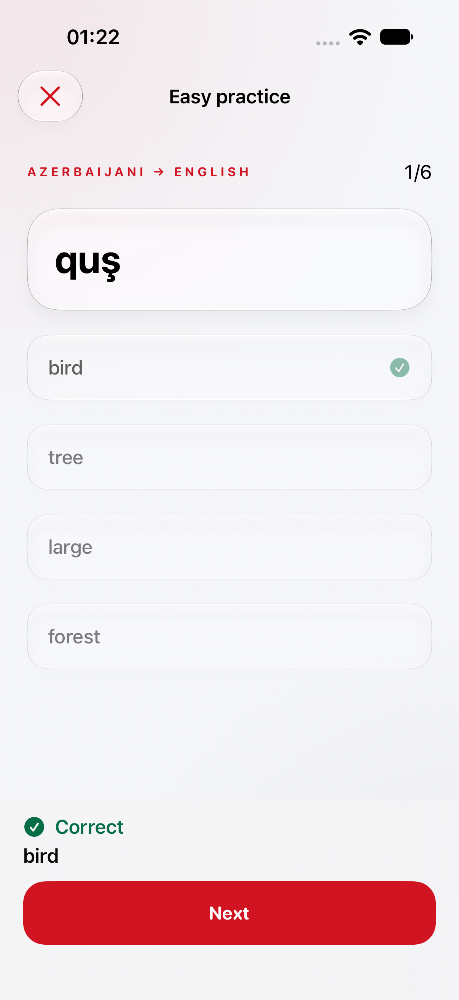
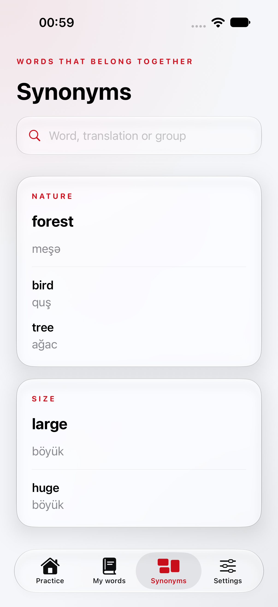

# WordRevisit

An offline English–Azerbaijani vocabulary app for iPhone and iPad. **Version 1.3.0 · iOS 18+ · SwiftUI.** Add words, practise in shuffled groups, and give every word a turn.

## Screenshots

Screenshots show WordRevisit 1.3.0 with sample vocabulary in the simulator. The black, white and red interface supports System, Light and Dark appearance, with emerald feedback for correct answers and cherry red for incorrect answers.

| Practice | Answers | Synonyms |
|:---:|:---:|:---:|
|  |  |  |

## Start here

1. Open **My words** to add, edit, delete or import vocabulary.
2. Choose **Easy** or **Hard** on **Practice**, then tap **Start practice**.
3. Answer and tap **Next** in the fixed bottom panel. In Hard mode, **Check answer** stays above the keyboard.
4. Finish a group, then continue with **Next group** or return home. There is no daily limit.
5. Find completed groups and their answers in **Settings → Practice history**.

## Every word gets a turn

A cycle starts with all vocabulary in a shared pool. Each group draws up to **20 random words**, without replacement. A remainder of fewer than 20 words forms its own shorter group; it is not padded with repeats.

Missed words return once at the end of their group. The retry finishes each word for that cycle, whether the second answer is right or wrong. Once the last group and its retries are finished, **Cycle complete** appears. Starting again creates a newly shuffled cycle.

Easy and Hard share the same pool. Change mode between groups; an unfinished group keeps its original mode. Newly added words join the current pool. Deleted words leave both the pool and any unfinished group. Previously completed history remains available.

The pool, current question, draft answer, submitted feedback and retry state are saved locally. Close and reopen the app to continue where you left off. Questions in an active group retain the wording they had when the group started; vocabulary edits apply to future groups.

### Easy

Answer with up to four choices. Each group mixes English → Azerbaijani and Azerbaijani → English questions equally, in random order. For odd-sized groups, one direction has one extra question.

Distractors come from the vocabulary and exclude words sharing any accepted Azerbaijani meaning with the target. If only two or three distinct choices are available, the question uses those choices. If there is only one distinct answer, that word uses written Azerbaijani → English recall so it is still covered by the cycle.

### Hard

See the Azerbaijani meaning and write the English word. Matching ignores letter case and extra whitespace; spelling and diacritics must otherwise match exactly.

Another English word in the vocabulary with a shared Azerbaijani meaning is also accepted. Feedback shows both your valid alternative and the target word. Every answer shows its result and the vocabulary answer before you continue.

## Vocabulary and CSV

Each word has three editable fields:

| Field | Required | Example |
|---|---|---|
| English | Yes | `large` |
| Azerbaijani | Yes | `böyük; iri` |
| Group | No | `size` |

Use semicolons to separate accepted meanings. Select individual words, **Select visible**, or **Delete all words** from **Manage words** to delete entries after confirmation. Export CSV before deleting vocabulary you might want to keep.

### Import

CSV files must be UTF-8 with a header containing **English** and **Azerbaijani**. **Group** is optional. Columns are located by header name, so their order may vary; all other columns are ignored.

```csv
English,Azerbaijani,Group
large,böyük; iri,size
huge,nəhəng; böyük,size
forest,meşə,nature
```

Import preview shows new words, skipped duplicates and invalid rows before confirmation. An existing English word is always skipped, even if its translation or group differs. The first occurrence within a file is kept; later duplicates are skipped. Duplicate checks ignore case and extra whitespace. An unfinished quoted field stops the import.

For quick entry, **Manage words → Paste words** accepts one `word - translation` pair per line.

### Export and starter words

**Export CSV** writes exactly `English,Azerbaijani,Group`. CSV contains vocabulary only, not practice history or the unfinished group.

A fresh installation includes **287 unique words** from [Data/Vocabulary.csv](Data/Vocabulary.csv). The supplied file contains 298 rows; its 11 duplicate English entries are skipped, keeping each first occurrence.

## Synonyms

The **Synonyms** tab builds word-family blocks automatically from **Group**. The first word added to each group is its heading; the other words appear underneath with their translations. Words without a group are omitted. Search matches English, Azerbaijani or the group name and shows the whole matching block.

The layout uses one column on narrow screens and two or three on wider screens. These are your own vocabulary families; the app does not generate or verify synonym relationships.

## Settings and Xcode renewal

Choose **System**, **Light** or **Dark**. The header logo follows that appearance. **Practice history** records first-attempt scores and the separate one-time retries; older 1.2 sessions retain the history detail originally saved.

Enable **Xcode renewal** for a local reminder six days after enabling it or tapping **I reinstalled from Xcode**. Tap that button after each successful reinstall. The reminder estimates when a free install may expire; it does not inspect the provisioning profile or renew the app. Delivery follows notification permission and the iPhone's Focus settings.

## Release and data compatibility

**1.3 replaces the 2.x workflow following issues with practice navigation and the expanded learning flow.** The 2.x daily plan, review stages, streaks, statistics, advanced word fields, dedicated synonym quiz, quiet hours and JSON backup interface are retired. System/Light/Dark, the adaptive logo, Xcode renewal and practice history remain.

This version reads the original **1.2 local data format** and preserves its vocabulary and practice history. It keeps a local copy of the old file before converting it. Word definitions, examples and other removed fields are not part of the new vocabulary model.

**2.0 and 2.1 data are not migrated.** Before switching from either version, use that version to export the vocabulary you need as CSV. You may also keep its full backup for use with that older version. Version 1.3 does not import JSON backups.

If 1.3 finds a 2.x or unreadable file, it leaves the file untouched and displays a recovery screen. **Start with the new vocabulary** requires confirmation, preserves that old file separately on the device, and starts with the bundled vocabulary and empty practice history. You can then import CSV; existing English entries are skipped. To replace the bundled vocabulary entirely, delete it first through **My words**, then import your CSV.

Keep the same bundle identifier when installing an update over an existing app. Deleting the app removes its local files, including any local recovery copies. Keep exported CSV outside the app before removing it. CSV does not preserve history or practice state.

## Run on an iPhone without the App Store

Requirements: a Mac with Xcode 26 or later, an iPhone running iOS 18 or later, and an Apple Account.

1. Open `WordRevisit.xcodeproj` in Xcode.
2. Sign in under **Xcode → Settings → Accounts**.
3. Select the **WordRevisit** target. Under **Signing & Capabilities**, enable **Automatically manage signing** and choose your **Personal Team**. Use a unique bundle identifier for your first installation, then keep that identifier for updates.
4. Connect and unlock the iPhone, trust the computer, and enable **Settings → Privacy & Security → Developer Mode** when prompted.
5. Select your named iPhone as the run destination and press **Run** (`⌘R`).
6. If iOS blocks the developer certificate, trust your account under **Settings → General → VPN & Device Management**, following any restart prompt.

For **“Your team has no devices from which to generate a provisioning profile”**, check that your unlocked, trusted phone appears in **Window → Devices and Simulators** and is selected as the run destination. Check your Personal Team and automatic signing settings.

A free Personal Team install normally expires after seven days. Run from Xcode again to renew it. See [Apple's device-run guide](https://developer.apple.com/documentation/xcode/running-your-app-on-simulated-or-physical-devices) and [free-account limits](https://developer.apple.com/help/account/basics/about-your-developer-account).

## Code and checks

```text
Sources/
├── Models/      Vocabulary, practice pool, sessions and answer history
├── Services/    Question generation, CSV preview and Xcode renewal reminders
├── Data/        Atomic persistence and version compatibility
└── Views/       Practice, vocabulary, synonym families and settings
```

There are no third-party dependencies. From `WordRevisit/`, with Xcode selected:

```bash
swiftc Sources/Models/*.swift Sources/Services/*.swift Tests/LogicChecks.swift -o /tmp/WordRevisitLogicChecks
/tmp/WordRevisitLogicChecks
swiftc Sources/Models/*.swift Sources/Services/*.swift Sources/Data/WordRepository.swift Tests/RepositoryChecks.swift -o /tmp/WordRevisitRepositoryChecks
/tmp/WordRevisitRepositoryChecks
```

These check full-cycle coverage, short final groups, one-time retries, adding/deleting words, exact and alternative answers, CSV duplicate handling, saved sessions, 1.2 conversion and rejection of 2.x files without changing them. Select a simulator and use **Product → Test** (`⌘U`) for the interface checks, including reaching **Next** without scrolling. UI tests use an isolated temporary vocabulary.

## License

MIT. See [LICENSE](LICENSE).
