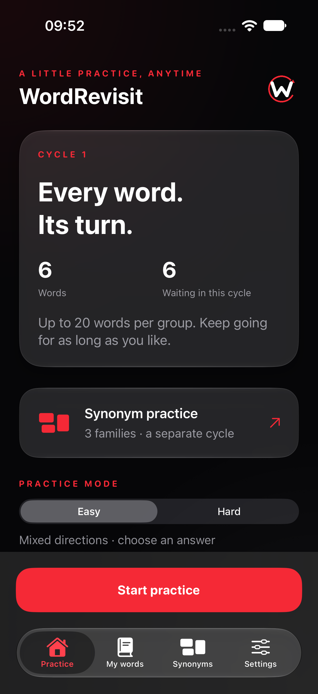
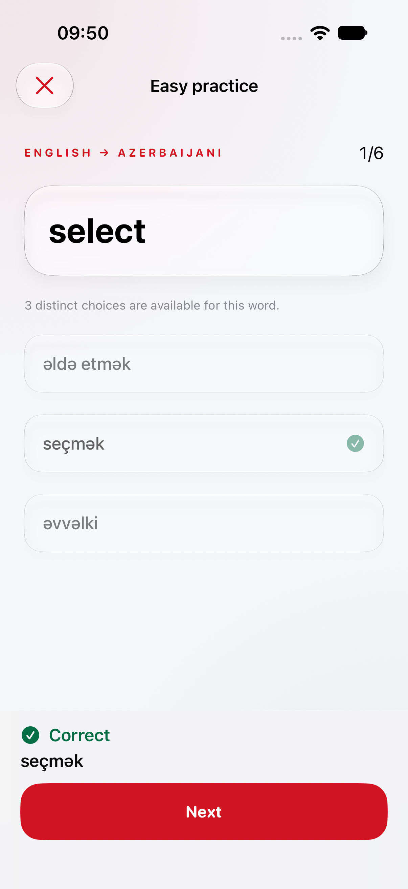
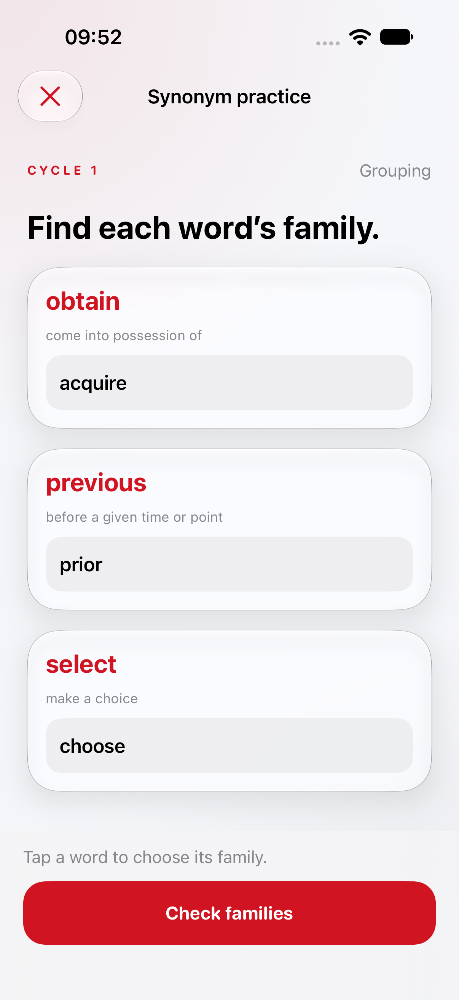

# WordRevisit

An offline English–Azerbaijani vocabulary app for iPhone and iPad. **Version 1.4.0 · iOS 18+ · SwiftUI.** Add words, practise in shuffled groups, and give every word a turn.

## Screenshots

Screenshots show WordRevisit 1.4.0 with sample vocabulary in the simulator. The black, white and red interface supports System, Light and Dark appearance, with emerald feedback for correct answers and cherry red for incorrect answers.

| Practice | Answers | Synonym practice |
|:---:|:---:|:---:|
|  |  |  |

## Start here

1. Open **My words** to add, edit, delete or import vocabulary.
2. Choose **Easy** or **Hard** on **Practice**, then tap **Start practice**.
3. Answer and tap **Next** in the fixed bottom panel. In Hard mode, **Check answer** stays above the keyboard.
4. Finish a group, then continue with **Next group** or return home. There is no daily limit.
5. Open **Synonym practice** on the home screen for separate Grouping or Easy rounds.
6. Find completed word groups and synonym rounds in **Settings → Practice history**.

## Every word gets a turn

A cycle starts with all vocabulary in a shared pool. Each group draws up to **20 random words**, without replacement. A remainder of fewer than 20 words forms its own shorter group; it is not padded with repeats.

Missed words return once at the end of their group. The retry finishes each word for that cycle, whether the second answer is right or wrong. Once the last group and its retries are finished, **Cycle complete** appears. Starting again creates a newly shuffled cycle.

Easy and Hard share the same pool. Change mode between groups; an unfinished group keeps its original mode. Newly added words join the current pool. Deleted words leave both the pool and any unfinished group. Previously completed history remains available.

The pool, current question, draft answer, submitted feedback and retry state are saved locally. Close and reopen the app to continue where you left off. Questions in an active group retain the wording they had when the group started; vocabulary edits apply to future groups.

### Easy

Answer with up to four choices. Each group mixes English → Azerbaijani and Azerbaijani → English questions equally, in random order. For odd-sized groups, one direction has one extra question.

Distractors come from the vocabulary and exclude words sharing any accepted Azerbaijani meaning with the target. If only two or three distinct choices are available, the question uses those choices. If there is only one distinct answer, that word uses written Azerbaijani → English recall so it is still covered by the cycle.

### Hard

See the Azerbaijani meaning and write the English word. Matching ignores letter case and extra whitespace; spelling and diacritics must otherwise match exactly.

Another English word in the vocabulary with a shared Azerbaijani meaning is also accepted. Feedback shows both your valid alternative and the target word. Every answer shows its result and the vocabulary answer before you continue.

## Vocabulary and CSV

Each word has three editable fields:

| Field | Required | Example |
|---|---|---|
| English | Yes | `large` |
| Azerbaijani | Yes | `böyük; iri` |
| Group | No | `sel02092wr` (multiple codes separated by `;`) |

Use semicolons to separate accepted meanings. Select individual words, **Select visible**, or **Delete all words** from **Manage words** to delete entries after confirmation. Export CSV before deleting vocabulary you might want to keep.

### Import

CSV files must be UTF-8 with a header containing **English** and **Azerbaijani**. **Group** is optional. Columns are located by header name, so their order may vary; all other columns are ignored.

```csv
English,Azerbaijani,Group
select,seçmək,sel02092wr
choose,seçmək,sel02092wr
pick,seçmək; yığmaq,sel02092wr
```

Preview shows **new**, **updated**, **unchanged**, **combined duplicate rows**, and **invalid rows** before confirmation. Matching ignores case and extra whitespace in English:

- A new English word is added to the current ordinary practice pool.
- An existing word keeps its ID, position and cycle progress; its translation and Group are updated from the file. Words absent from the file remain in the app.
- Repeated English rows within the same file combine distinct meanings and group memberships, retaining their original order.
- A missing Group column preserves existing groups. A present but empty Group clears them.
- Extra columns are ignored. Invalid rows are reported and skipped; an unfinished quoted field stops the import.

Questions already in an ordinary practice group keep their original wording until that group ends. Import does not reset its pool or unfinished answers.

For quick entry, **Manage words → Paste words** accepts one `word - translation` pair per line.

### Export and starter words

**Export CSV** writes exactly `English,Azerbaijani,Group`. CSV contains vocabulary only, not practice history or the unfinished group.

A fresh installation includes **513 unique words** in [Data/Vocabulary.csv](Data/Vocabulary.csv). All words and Azerbaijani meanings from the supplied 524-row file are retained; its 11 repeated English rows are combined. The original file is preserved in [Data/SourceVocabulary-v2.csv](Data/SourceVocabulary-v2.csv).

## Synonym families

The **Synonyms** tab shows **94 reviewed, sense-specific families** when all starter words are present. Each block states the shared meaning, then shows its head word and remaining members with their Azerbaijani translations. Related topics, opposites and similar spellings alone do not make a synonym family. Words such as `terrestrial`, `aquatic`, `nocturnal`, `diurnal`, `inhibit` and `inhabit` remain in the vocabulary without being grouped together as synonyms.

Group codes identify families. For example, `sel02092wr` means the first three letters of `select`, two synonyms besides the head, family 092, and `wr`. Multiple memberships use `;`. Codes remain stable after creation; deleting a member does not rename its family. The app displays English headings and meanings, rather than codes. Head selection comes from the reviewed catalogue, independent of CSV row order. If the head is absent, the first remaining catalogue member becomes the heading. Families with fewer than two available members are hidden.

Only reviewed term–family memberships appear in Synonyms and synonym practice. Recognized labels from the supplied older CSV are converted to the corresponding codes; topical memberships are removed. Unknown custom labels are retained for CSV export but do not automatically create a synonym relationship. To extend the reviewed catalogue, edit [Data/SynonymFamilies.json](Data/SynonymFamilies.json) and regenerate the data as described below.

Search finds complete blocks by English, Azerbaijani, shared meaning or code. The layout uses one column on phones and two or three on wider screens. Synonyms share the stated sense; they are not interchangeable in every sentence. The supplied translations are preserved, including other meanings of polysemous words.

## Separate synonym practice

Launch **Synonym practice** from **Practice**. The bottom navigation remains **Practice · My words · Synonyms · Settings**.

### Grouping

A round draws up to three random families from its own shuffled pool. Families sharing any word, including their heads, cannot appear together. Tap a synonym chip, then select its family in the fixed bottom panel. You can move chips until you press **Check families**. Feedback marks each placement and shows the correct family for mistakes.

All synonyms in each selected family appear; round size follows family size instead of dropping words to force a fixed chip count. If only one compatible family remains for a round, it uses Easy. Other families stay in the pool for later rounds.

### Easy

See a head word and its shared meaning, then choose a synonym. Each non-head member gets a question. Alternatives exclude members and known synonyms of that family, as well as words sharing a supplied Azerbaijani meaning. Use two or three choices when four distinct choices are unavailable. If no distractor exists, the app offers an unscored review of the synonym.

### Progress and saving

Both synonym modes share their own family pool, separate from ordinary Easy/Hard word practice. Every family is drawn once per cycle. Incorrect placements or choices return once; after that, the family is complete regardless of the retry result. **Next** stays in the fixed bottom panel. Finish a round, then choose the next mode or return home.

The selected families, chip placements, current question, feedback and retry state survive closing the app. Completed scored rounds appear in **Settings → Practice history**. New eligible families join the current synonym pool. If edits or deletion change a family in an unfinished synonym round, that round is rebuilt: surviving families return to the pool and a message appears on Home. Other cycle progress and ordinary practice remain intact.

## Settings and Xcode renewal

Choose **System**, **Light** or **Dark**. The header logo follows that appearance. **Practice history** records first-attempt scores and the separate one-time retries; older 1.2 sessions retain the history detail originally saved.

Enable **Xcode renewal** for a local reminder six days after enabling it or tapping **I reinstalled from Xcode**. Tap that button after each successful reinstall. The reminder estimates when a free install may expire; it does not inspect the provisioning profile or renew the app. Delivery follows notification permission and the iPhone's Focus settings.

## Updates and data compatibility

**1.4.0** adds separate synonym practice, reviewed family codes, CSV updates without deleting vocabulary, and the expanded 513-word vocabulary. Ordinary Easy/Hard practice, System/Light/Dark, the adaptive logo and Xcode renewal remain available.

### From 1.3

Install over the existing app with the same bundle identifier. On the first 1.4 launch, the app preserves a local recovery copy of the old file and upgrades it once. Existing word IDs, custom words, history, appearance, renewal settings, pool and unfinished ordinary group are retained. New supplied words join the current pool. Existing words keep their meanings, with new supplied meanings added; known starter groups become reviewed codes. Unknown custom labels are retained. Words you delete after upgrading are not re-added on subsequent launches.

### From 1.2

The original 1.2 local format remains readable. Vocabulary and history are preserved, the supplied vocabulary is added, and a new shuffled practice pool is created. A local copy of the old file is retained before conversion. Definitions, examples and other retired fields are not editable in the current model.

### From unreleased 2.x development builds

The 2.0/2.1 development workflow was replaced by 1.3 following practice navigation and learning-flow issues; **2.x was not a public release**. Its daily plan, stages, streaks, expanded statistics, advanced word fields, quiet hours and JSON backup interface remain retired. The synonym practice in 1.4 uses the separate family cycle described above.

**2.x local files and JSON backups are not migrated.** Before switching, open that development build and export the vocabulary as CSV. Keep its full backup if you need its old history. This app imports CSV vocabulary, not JSON backups.

If the app finds an unsupported or unreadable file, it leaves it untouched and displays a recovery screen. **Start with the new vocabulary** requires confirmation, archives the old file separately on the device, and starts with 513 words and empty practice history. You can then import your CSV to add or update words. To use only your own vocabulary, delete the starter words in **My words** first, then import.

Deleting the app removes its local files and local recovery copies. Export CSV outside the app before removing it or changing its bundle identifier. CSV preserves vocabulary, not practice history or the current cycle.

## Run on an iPhone without the App Store

Requirements: a Mac with Xcode 26 or later, an iPhone running iOS 18 or later, and an Apple Account.

1. Open `WordRevisit.xcodeproj` in Xcode.
2. Sign in under **Xcode → Settings → Accounts**.
3. Select the **WordRevisit** target. Under **Signing & Capabilities**, enable **Automatically manage signing** and choose your **Personal Team**. Use a unique bundle identifier for your first installation, then keep that identifier for updates.
4. Connect and unlock the iPhone, trust the computer, and enable **Settings → Privacy & Security → Developer Mode** when prompted.
5. Select your named iPhone as the run destination and press **Run** (`⌘R`).
6. If iOS blocks the developer certificate, trust your account under **Settings → General → VPN & Device Management**, following any restart prompt.

For **“Your team has no devices from which to generate a provisioning profile”**, check that your unlocked, trusted phone appears in **Window → Devices and Simulators** and is selected as the run destination. Check your Personal Team and automatic signing settings.

A free Personal Team install normally expires after seven days. Run from Xcode again to renew it. See [Apple's device-run guide](https://developer.apple.com/documentation/xcode/running-your-app-on-simulated-or-physical-devices) and [free-account limits](https://developer.apple.com/help/account/basics/about-your-developer-account).

## Code and checks

```text
Sources/
├── Models/      Vocabulary, reviewed families, independent practice pools and sessions
├── Services/    Question generation, CSV preview and Xcode renewal reminders
├── Data/        Atomic persistence and version compatibility
└── Views/       Practice, vocabulary, synonym families and settings
```

There are no third-party dependencies. From `WordRevisit/`, with Xcode selected:

```bash
swiftc Sources/Models/*.swift Sources/Services/*.swift Tests/LogicChecks.swift -o /tmp/WordRevisitLogicChecks
/tmp/WordRevisitLogicChecks
swiftc Sources/Models/*.swift Sources/Services/*.swift Sources/Data/WordRepository.swift Tests/RepositoryChecks.swift -o /tmp/WordRevisitRepositoryChecks
/tmp/WordRevisitRepositoryChecks
```

These check ordinary and synonym cycle coverage, overlapping-family exclusion, every member receiving a turn, one-time retries, saved placements and answers, CSV upserts, preservation of every supplied meaning, 1.2/1.3 migration, and rejection of unsupported files without changing them. Select a simulator and use **Product → Test** (`⌘U`) for the interface checks, including reaching **Next** without scrolling. UI tests use an isolated temporary vocabulary.

To regenerate the canonical CSV and Swift vocabulary/catalogue after editing the source data:

```bash
python3 Scripts/GenerateVocabulary.py
```

The original source file preserves the supplied meanings. `SynonymFamilies.json` defines reviewed members, their shared sense, head and stable code. The generator checks unique codes, valid members and the expected vocabulary size. When adding a new family, allocate a new sequence number; do not reuse or renumber existing codes.

## License

MIT. See [LICENSE](LICENSE).
