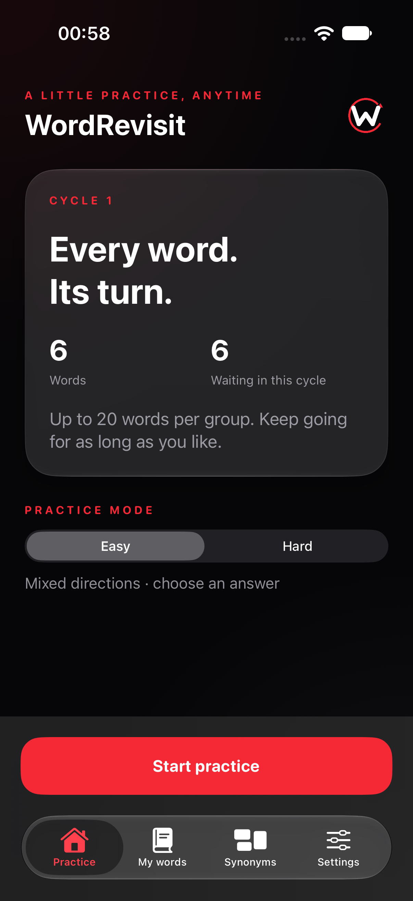
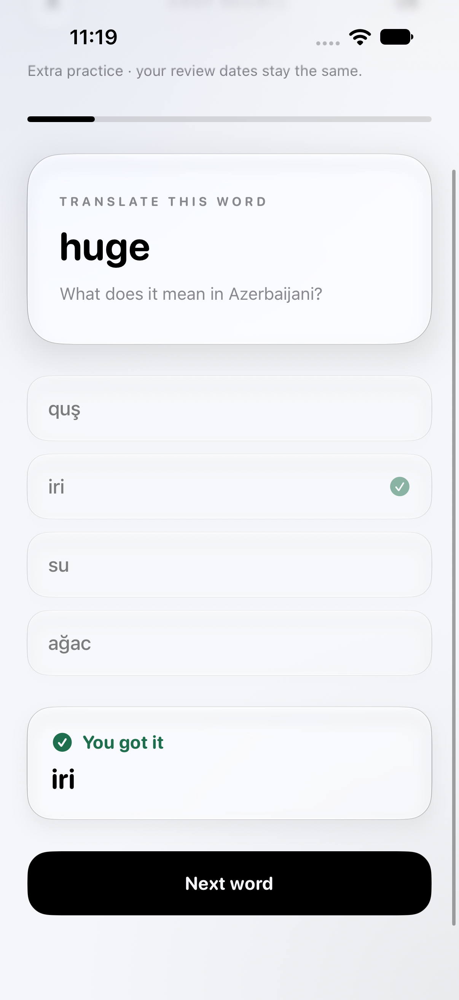
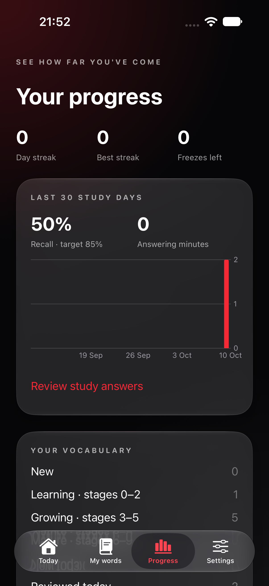

# WordRevisit

A native, offline iPhone app for learning English with Azerbaijani translations. **Version 2.0.0**, iOS **18+**, SwiftUI. No account, advertisements, analytics, backend, or network calls. The first installation includes the original 59-word collection.

## Screenshots

Version 2.0 running in an iOS 27 simulator with isolated demonstration data. The black, white, and red interface uses Liquid Glass on iOS 26+ and native materials on iOS 18–25.

| Today's plan | Recall and feedback | Progress |
|:---:|:---:|:---:|
|  |  |  |

## Start here

1. Open **My words** to add or edit words. Each word can have a definition, examples, part of speech, synonym group, memory hook, and your own sentence.
2. Use **Import CSV** or **Manage words → Paste words**, review the counts, and confirm the import.
3. Tap **Start today's plan**. Meet new words, recall them after short gaps, then complete their mini-test. Close at any point and use **Continue saved session** later.
4. Use **Progress** to review saved answers and difficult words.
5. Export a full JSON backup from **Settings → Backup & restore** before removing the app or changing its bundle identifier.

## Daily learning

- The default target is **20 new words**, in **two batches of 10**, alongside due reviews. Choose one, two, or four batches.
- New words follow collection/import order. Words sharing a synonym group or an Azerbaijani meaning are introduced on different study days.
- Due reviews prioritise the oldest due date and then the lowest stage. Equal-priority cards are shuffled. Free quizzes also shuffle ties instead of using alphabetical order.
- Every question keeps its identity and expected answer until you explicitly continue. Duplicate Enter/button submissions are ignored.
- At the start of a study day, over 100 due reviews halves the new-word allowance; over 150 pauses it. Paused intake resumes below 100. The daily review limit is 200 distinct words; extra reviews remain due.
- After at least two missed days, the comeback day has no new words and at most 40 reviews.
- A study day starts at **04:00 local time**. Saved answers retain their study-day key when the device's time zone changes.
- The daily minimum is **15 distinct words practised**, or the entire available queue when smaller. Mistakes count as practice; repeating one word does not inflate the minimum. Completing all scheduled words finishes the full plan.
- Each seven consecutive completed study days earns a streak freeze, with up to two saved. A freeze covers a missed day automatically; the best streak remains recorded.
- The plan's daily limits are fixed for that study day. Changes to those limits apply to the next day; adding or deleting vocabulary updates the remaining available work.

### New words and review stages

An introduction shows the word, translations, definition and examples. Add an optional memory hook, learn the word, mark it already known, or leave it for tomorrow. Already-known words enter stage 5. Learning steps default to **1 minute**, then **10 minutes**, followed by a mini-test. A waiting session is saved and can be closed; reminders can announce its next ready card.

| Stage | Review interval |
|---|---|
| 1–3 | 1, 2, 4 days |
| 4–6 | 8, 16, 30 days |
| 7–9 | 60, 120, 180 days |

Correct, unassisted, timely recall advances a stage. A correct answer with a hint, a single spelling error in a word of at least five letters, or a longer response is **Hard** and keeps the stage. Default response thresholds are 5 seconds for choices and 12 seconds for typing; these are adjustable.

A wrong answer or **I don't know** drops two stages, with a minimum of stage 1. It returns after 3–5 other cards where enough cards are available, needs two correct recovery answers, and is then due tomorrow. Longer intervals receive a configurable ±10% spread. Very overdue words receive an easier question tier.

After four mistakes a word is labelled difficult and the feedback offers a memory hook. At most 15 difficult words stay active; excess words pause for seven days. You can also pause or resume any word manually.

### Questions and synonyms

Early stages use English/Azerbaijani choices; later stages add definitions, cloze sentences, and written recall. Definitions and cloze questions are only used when the necessary content exists. Cloze blanks whole-word occurrences in your example sentence. If four unambiguous options cannot be built, the question uses written recall instead. Distractors exclude words with shared meanings or the same synonym group, and respect part of speech when supplied.

Assign matching **Synonym group** names to related words. **Practise synonyms** becomes useful when at least two words in a group reach stage 3 and three distinct distractors are available. It asks you to select the matching synonym; it does not invent contextual distinctions from a plain list. Synonym practice leaves review dates and daily minimums unchanged.

Daily questions show examples through **Show sentence hint**, then show examples, definitions and memory hooks after answering. Your own sentence can be saved and shared from the editor. There is no automatic sentence grading or pronunciation feature.

**Easy recall** (English → Azerbaijani) and **Hard recall** (Azerbaijani → English) remain available as free practice. Their example hints stay visible, results can be reviewed, and missed words can be retried. Free practice does not change daily review stages or dates. Its quiz history is kept separately; resumable sessions apply to the daily plan and synonym practice.

## Manage words and import

Use **Manage words → Select words**, tap individual rows, or choose **Select visible**, then confirm deletion. **Delete all words** is a separate confirmed action. Deleting words removes their schedules and pending cards, while retaining past answer history. Search includes English, Azerbaijani and group names; filters cover new, learning, review, difficult, paused and synonym entries.

CSV is a UTF-8 plain-text table:

```csv
English,Azerbaijani,Definition,Examples,PartOfSpeech,Group,Mnemonic,MySentence
large,böyük,Of considerable size.,A large forest.,adjective,size,,
huge,iri; böyük,Extremely large.,A huge tree.,adjective,size,,
```

English and Azerbaijani are required. The remaining columns are optional, in the order shown. Old two-, three-, and four-column files still work; empty definitions, quoted commas, escaped quotes and multiline examples are supported. A semicolon separates accepted meanings.

The preview reports new entries, merged entries, skipped duplicates and invalid rows. Identical word/meaning pairs are skipped. For the same word with a different translation, choose **merge**, **keep separate**, or **skip**. Merging retains existing review progress. Invalid rows are reported and skipped after confirmation; an unfinished quoted field stops the preview.

For quick paste, use one pair per line:

```text
forest - meşə
water - su
```

CSV carries vocabulary and notes only. **JSON backup** also carries stages, dates, history, settings and the saved session. Restore validates the file before replacing data, asks for confirmation and keeps a local copy of the previous file. Files larger than 64 MB, unsupported schemas and malformed learning data are rejected. An optional backup reminder defaults to every seven days.

## Notifications

Daily reminders default to **09:00 and 20:30**. A 22:00 reminder is scheduled only when no study has started; the daily minimum cancels the remaining daily reminders. Quiet hours default to **23:00–07:00**. Tapping a study notification opens or resumes the session. The app refreshes a seven-day notification schedule on use. Notification delivery still follows the iPhone's permission and Focus settings.

The separate **Xcode renewal** reminder is preserved. Backups and renewal are independent of the daily minimum.

## Updating from 1.2

Keep the same bundle identifier and installation. Existing words, examples and quiz histories are decoded with defaults for new fields; old due dates are preserved and old review streaks map to the new stages. Previous quiz days seed the streak history. The storage schema is version 2, writes are atomic, and an unreadable existing file is left untouched rather than overwritten with starter words.

## Run on an iPhone without the App Store

Requirements: a Mac with Xcode 26 or later, an iPhone running iOS 18 or later, a cable, and a free Apple Account.

1. Open `WordRevisit.xcodeproj` in Xcode.
2. In **Xcode → Settings → Accounts**, sign in with your Apple Account.
3. Select the **WordRevisit** target. Under **Signing & Capabilities**, enable **Automatically manage signing**, choose your **Personal Team**, and change the bundle identifier if Xcode asks for a unique one.
4. Connect and unlock your iPhone, select **Trust This Computer** if prompted, and enable **Settings → Privacy & Security → Developer Mode** on the phone if needed.
5. Choose your named iPhone as the Xcode run destination (not **Any iOS Device**) and press **Run** (`⌘R`). Xcode registers the phone and creates its development provisioning profile.
6. If iOS blocks the installed app, open **Settings → General → VPN & Device Management**, select your developer account, and trust its certificate. Follow any restart prompt, then open WordRevisit again.

If Xcode says **“Your team has no devices from which to generate a provisioning profile”**, check that the iPhone appears under **Window → Devices and Simulators**, is unlocked and trusted, and is selected as the run destination. Keep **Automatically manage signing** enabled and select your own Personal Team. If Xcode reports a bundle ID conflict, choose a unique bundle identifier for your copy.

The free Personal Team profile expires after **7 days**. Run the project from Xcode again to renew it. Export your words before removing the app or changing its bundle identifier. See [Apple's device-run guide](https://developer.apple.com/documentation/xcode/running-your-app-on-simulated-or-physical-devices) and [free-account limits](https://developer.apple.com/help/account/basics/about-your-developer-account).

For a heads-up, turn on **Xcode renewal** in Settings. The app sends one local notification six days after the date you enable it or tap **I reinstalled from Xcode**. Tap that button after each successful reinstall. The reminder is an estimate because the app does not inspect your provisioning profile; it cannot renew the install for you.

## Code map and checks

```text
Sources/
├── Models/      Codable words, learning settings, days, sessions and review logs
├── Services/    Learning engine, calendar rules, import preview, CSV and reminders
├── Data/        Atomic persistence, migration, backup and session transactions
└── Views/       SwiftUI screens and shared visual components
```

There are no third-party dependencies. Run these commands from `WordRevisit/` on a Mac with Xcode selected:

```bash
swiftc Sources/Models/*.swift Sources/Services/*.swift Tests/LogicChecks.swift -o /tmp/WordRevisitLogicChecks
/tmp/WordRevisitLogicChecks
swiftc Sources/Models/*.swift Sources/Services/*.swift Sources/Data/WordRepository.swift Tests/RepositoryChecks.swift -o /tmp/WordRevisitRepositoryChecks
/tmp/WordRevisitRepositoryChecks
swiftc Sources/Models/*.swift Sources/Services/*.swift Sources/Data/WordRepository.swift Tests/LearningChecks.swift -o /tmp/WordRevisitLearningChecks
/tmp/WordRevisitLearningChecks
```

Choose an iPhone simulator and **Product → Test** (`⌘U`) for UI checks: bulk delete and paste preview, daily answer identity and relaunch recovery, shuffled free quizzes and retries, and synonym practice. Debug tests use an isolated temporary store. Logic checks cover 298-row CSV import, legacy migration, intervals, learning steps, load protection, comeback, spelling tolerance, group separation, streak freezes, notification plans, invalid backup rejection and full restore. A 5,000-word load/plan check prints its measured time; device startup performance should be measured on the target iPhone.

## Agreed release scope

2.0 delivers the daily learning workflow, data management, backup, local reminders and basic synonym practice. XP, boss/speed games, achievements, widgets, FSRS, a 30-day workload forecast and context-sensitive synonym questions are reserved for later releases. Pronunciation and listening questions are intentionally excluded. No unfinished feature buttons are shown.

## License

MIT. See [LICENSE](LICENSE).
